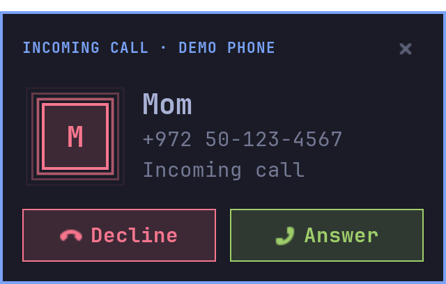
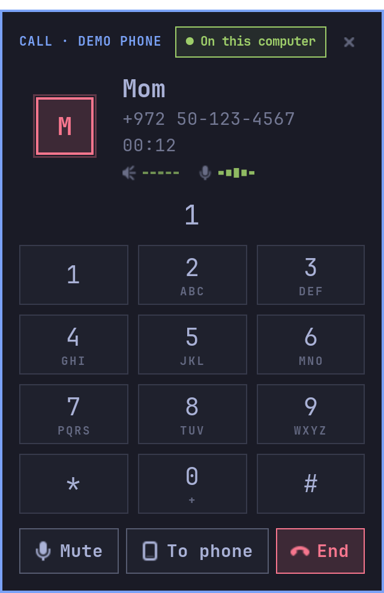
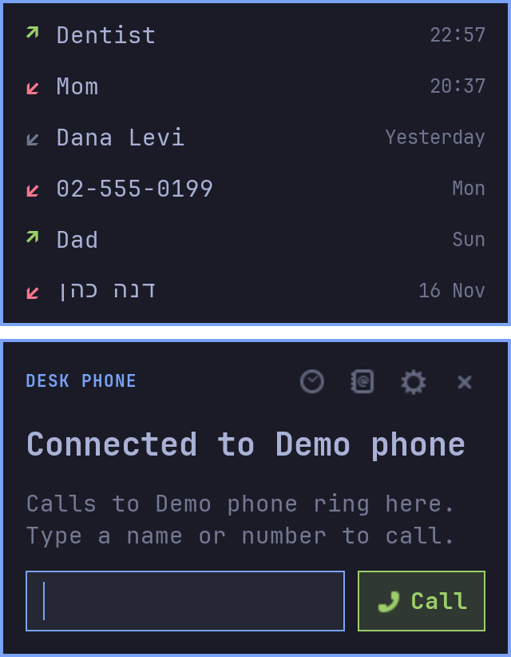

# Desk Phone

Answer your phone's calls on your Linux computer. You talk through the computer's mic and
speakers, a keypad sends tones into the call ("press 1 for…"), and you can dial out by name or
number. The computer acts as the phone's **Bluetooth hands-free kit**, the way a car does: the call
itself still goes through the phone and its SIM, and nothing goes through the internet.

<p>
  
  
  
</p>

It needs PipeWire 1.4 or newer, whose built-in call service (`org.pipewire.Telephony`) does the
Bluetooth work; Desk Phone is the screen, the keys and the audio routing for it. It was written
and is used on **Fedora with GNOME** and on **Omarchy** (Arch with Hyprland), with an Android
phone. Other desktops and distributions should work with the notes [below](#other-systems).

## What it does

- **When the phone rings:** a card pops up in the corner of the screen with the caller's name or
  number, plus **Decline** and **Answer**. The computer rings too.
- **After you answer here:** the call moves to the computer. The card shows a keypad (your
  keyboard's number keys, `*` and `#` work too), **Mute**, **To phone** and **End**.
- **Where the audio goes:** a call stays on the phone unless you answer it here. If you answer on
  the phone, the audio stays on the phone, and the card offers **To computer**. You can hand a
  call back and forth as often as you like. Settings has "Always on the computer" if you'd rather
  have it like a car kit.
- **Echo cancelling:** while the call is on the computer, the caller doesn't hear themselves back
  from your speakers.
- **Second calls:** a waiting call shows a banner (Answer puts the first call on hold), and a held
  call shows a **Swap** button.
- **Calling out:** open the card and type a name or a number. Matching contacts float above the
  card: click one, or pick with ↑/↓ and press Enter. The address-book button lists all of them.
- **Recent calls:** the clock button on the card (or ↓ in the empty box) lists the last 50 calls:
  answered, dialed, missed (in red) and declined, with the time. Click one, or pick it with ↑/↓
  and Enter, to call back. The list is kept on this computer only and can be turned off in
  Settings, which also deletes it. It holds the calls the phone had while Desk Phone was running;
  it doesn't read the phone's own call log.
- **Caller names:** names come from your phone's contacts, read over Bluetooth and kept only on
  this computer.
- **Keys that work anywhere:** one key answers, hangs up or opens the dialer; with Shift it
  declines, with Ctrl it mutes. See [Keys](#keys).
- **GNOME Contacts (optional, in Settings):** the address-book button can open GNOME Contacts
  instead, and the dialer's matches and callers' names can come from GNOME Contacts (including a
  Google account added in Online Accounts) instead of the phone. Desk Phone then takes `tel:`
  links, so a call button in GNOME Contacts, or a `tel:` link anywhere, calls through your phone.
  Settings can also copy the phone's contacts into an address book: only the ones whose numbers
  aren't there yet, after you confirm, never changing or deleting anything.
- **Live voice meters** next to the caller's name show the caller's voice and yours.
- **Follows the Omarchy theme:** on Omarchy the card, Settings and Contacts take the current
  theme's colors and font and Hyprland's border and corner rounding, and change with
  `omarchy theme set` while open. Elsewhere they use Omarchy's default look (Tokyo Night).
- **×** or Esc hides the card. The phone keeps ringing.

## Install

You need a phone paired over Bluetooth and a system with PipeWire 1.4 or newer and WirePlumber;
current Fedora, Arch and Omarchy have them. `pipewire --version` shows yours.

```sh
git clone https://github.com/yairHinkis/desk-phone.git
cd desk-phone
./install.sh
```

`install.sh` runs as you, not as root. It:

1. checks the system packages (Fedora: `dnf`, Arch: `pacman`) and, only if some are missing, shows
   them and asks before installing them with `sudo`;
2. copies the app to `~/.local/share/desk-phone` and writes the `desk-phone` command to
   `~/.local/bin`, so the folder you cloned can be moved or deleted afterwards;
3. adds Desk Phone to the app menu and to the apps that start at login;
4. tells PipeWire to leave calls on the phone unless you take them on the computer, with one small
   file, `~/.config/wireplumber/wireplumber.conf.d/60-desk-phone.conf`. The first time, this
   restarts WirePlumber: sound stops for a second and Bluetooth devices reconnect;
5. adds the [keys](#keys);
6. starts Desk Phone in the background and prints a check of the setup.

On **Fedora with GNOME** the keys are GNOME custom shortcuts (Settings → Keyboard → View and
Customize Shortcuts → Custom Shortcuts), and the card runs under XWayland, the only way a window
can stay on top in a corner on GNOME's Wayland.

On **Omarchy** the keys and two window rules are one marked block in
`~/.config/hypr/bindings.lua`, between `-- >>> desk-phone >>>` and `-- <<< desk-phone <<<`.
Nothing outside the block is touched. The rules float the card in the corner of every workspace
without a border, and keep it from taking the keyboard when it rings.

### Set up the phone

1. **Pair the phone** with the computer in the Bluetooth settings, if it isn't paired yet.
2. **On the phone:** Settings → Bluetooth → ⚙ next to this computer → turn on **Phone calls**
   (sometimes "Calls" or "Phone audio"). Turning on **Contact sharing** too lets the card show
   caller names; the first time, the phone asks whether to allow it.
3. `desk-phone --check` lists what's in place and what's missing, and `desk-phone --connect` asks
   the phone to connect for calls.

Try the card without a phone: `desk-phone --demo`. A pretend phone rings after a second.

### Update

```sh
cd desk-phone
git pull
./install.sh
```

Running `install.sh` again replaces the app and restarts it. It keeps your settings, a key you
chose, and the place of the block in `bindings.lua`, and it leaves WirePlumber alone unless its
file changed.

### Remove

```sh
desk-phone --uninstall
```

(or `./uninstall.sh` from the cloned folder). It asks first, then removes the keys, the start at
login, the WirePlumber file (WirePlumber restarts once more), the app-menu entry, the copy of the
app and the command, and Desk Phone's settings, cached contacts, recent calls and log.
`--keep-data` keeps those last four. System packages that `install.sh` installed stay.

Without the WirePlumber file, a connected phone sends every call's audio to the computer again,
as it did before; turn off "Phone calls" for the computer on the phone if you don't want that.

### Other systems

- **Another distribution:** `install.sh` skips the package check. Desk Phone needs Python 3.11 or
  newer with PyGObject, GTK 3, GStreamer with its PipeWire plugin, PipeWire 1.4 or newer with
  `pw-dump`, `pw-metadata` and `wpctl`, WirePlumber, BlueZ (with `obexd` for caller names), and
  XWayland outside Hyprland.
- **Another desktop:** the keys aren't added for you. `install.sh` prints the three commands to
  bind in your desktop's own shortcut settings. The card stays on top in its corner through
  XWayland, which has only been tried on GNOME.
- **Hyprland without Omarchy:** not supported as it is, and not tried. The block above is written
  with Omarchy's `o.bind` and `o.window` helpers, so `install.sh` doesn't write it there, and
  without the window rules Hyprland would tile the card like any window. You'd add the same to
  your own config: float and pin the window of class `io.github.yairhinkis.DeskPhone` titled `Desk Phone`
  in the bottom-right corner, without border, shadow, blur, rounding, animation or initial focus,
  and float and center its Settings and Contacts windows.
- **A package instead of `install.sh`:** the app is the `desk_phone` Python package and has no
  build step. A package that puts it on the system's Python path with a `desk-phone` command and
  the files in `desk_phone/data` needs each user to run `desk-phone --setup` once, which does
  steps 3 to 5 above; `desk-phone --uninstall` undoes them.

## Keys

They work anywhere, even when the card is hidden. All three are on one key: `XF86LinkPhone`, the
phone key some laptops have (F11 on the ThinkPad this was written on), or `XF86Display`, the
screen key, when the keyboard data doesn't know the phone key.

| Key | Does |
|---|---|
| **key** | Answers a ringing call on the computer (the card then takes the keyboard, so number keys go into the call); during a call, hangs up; with no call, opens the dialer, or closes it if it's open (and starts Desk Phone if it isn't running) |
| **Shift+key** | Declines a ringing call; during a call, brings the call card forward |
| **Ctrl+key** | While it rings: silences only the computer's ringtone. In a call: mutes your mic for the call only (press again to unmute) |

Put them on any other key with `desk-phone --install-shortcuts F9` (a key name as your desktop
writes it). `desk-phone --remove-shortcuts` takes them away.

On the card itself: the number keys, `*` and `#` send tones during a call, ↓ in the empty dialer
opens the recent calls, and Esc hides the card.

## Commands

| Command | What it does |
|---|---|
| `desk-phone` | Starts it, or shows the card with the dialer if it's already running |
| `desk-phone --answer` / `--decline` / `--mute` | Same as the keys above |
| `desk-phone --settings` | Opens the settings |
| `desk-phone --quit` | Quits; calls then stay on the phone |
| `desk-phone --demo` | Runs the card with a pretend phone |
| `desk-phone --check` | Checks the setup |
| `desk-phone --connect` | Connects the phone for calls |
| `desk-phone --setup` | Sets up the app-menu entry, the WirePlumber file, the keys and start at login again |
| `desk-phone --uninstall` | Removes Desk Phone (see [Remove](#remove)) |
| `desk-phone --version` | Shows the version |

## What it keeps, and where

Everything stays on the computer. Desk Phone doesn't go online and sends nothing anywhere.

| What | Where | Readable by |
|---|---|---|
| The phone's contacts, for names | `~/.cache/desk-phone/contacts-….json` | you alone |
| Recent calls | `~/.local/state/desk-phone/calls.json` | you alone |
| The log (it names the numbers of calls) | `~/.local/state/desk-phone/desk-phone.log` | you alone |
| Settings | `~/.config/desk-phone/config.json` | as your other settings |

"Caller names from the phone" and "Recent calls" in Settings turn the first two off and delete
them. If you copy the phone's contacts into an online address book in Settings, that address
book's account syncs them, as it does with every contact in it.

## How it works

- **The phone:** PipeWire registers the computer as a hands-free device (HFP HF). Every phone
  connected that way shows up as `/org/pipewire/Telephony/agN` on the session bus, with its calls
  under it. Desk Phone watches those and calls `Answer`, `Hangup`, `SendTones`, `Dial`,
  `HoldAndAnswer` and `SwapCalls`.
- **Where the audio goes:** the `RejectSCO` property decides whether the phone may send a call's
  audio to the computer. It stays on (calls stay on the phone) until you answer or dial here. Then
  Desk Phone turns it off and, if the phone doesn't send the audio by itself, asks for it with
  `Activate`.
  - **To phone** turns it back on and briefly switches the phone's PipeWire card off, so the audio
    link closes and the phone takes the call back.
  - The WirePlumber setting `bluez5.telephony.default-reject-sco` keeps this the default even
    while Desk Phone isn't running.
- **Echo cancelling:** while a call's audio is here, Desk Phone runs
  `pipewire -c …/desk_phone/data/echo-cancel.conf`, a small PipeWire process that loads PipeWire's
  own WebRTC echo canceller and ends with the call. Desk Phone moves the call's two Bluetooth
  streams onto that process's nodes (`pw-metadata … target.object`).
- **Caller names:** the contacts come from the phone's phonebook (PBAP) through BlueZ's obexd.
- **The keys** run `gdbus call … org.gtk.Actions.Activate`, which asks the running Desk Phone to
  act, so they're instant.

## Limits

- The phone has to stay within Bluetooth range, about 10 m.
- Voice quality is that of a car kit or a Bluetooth headset (narrow- or wide-band).
- It's made for regular phone calls. Calls in apps like WhatsApp go through the hands-free kit
  only if the app hands them to the phone's dialer.
- It has been used with one Android phone. Hands-free calling is a standard every phone has, so
  others, iPhones included, should work, but they haven't been tried.
- The recent calls miss whatever happened while the phone was out of range or Desk Phone wasn't
  running, and a call you declined on the phone itself shows as missed.
- On Hyprland the card always opens bottom-right: Wayland doesn't let a window place itself, so
  the window rule does it, and "Where the card opens" in Settings and dragging are for GNOME.
  Super+drag moves the card until it closes.

## Working on it

```sh
./run.sh --demo            # run from this folder, with a pretend phone
./install.sh --link        # install, but run the code from this folder instead of a copy
```

The tests drive the app's logic against a pretend phone on a private D-Bus session. They need
`pytest`, which can live in a virtual environment that sees the system's PyGObject:

```sh
python3 -m venv --system-site-packages .venv
.venv/bin/pip install pytest
make test PY=.venv/bin/python
```

`make ui-check` drives the real card through the recent-calls list on an off-screen display
(it needs `xvfb-run`).

The log is in `~/.local/state/desk-phone/desk-phone.log`. For more detail in it, quit Desk Phone
and start it with `desk-phone --debug`.

## License

[MIT](LICENSE)
